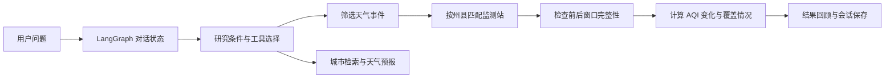

# AQI Analysis Agent 🌦️

**用自然语言探索天气事件前后的空气质量变化。**

基于 **LangGraph · Ollama · pandas** 的天气与空气质量分析助手。围绕美国得克萨斯州的天气事件与臭氧 AQI 数据，支持多轮研究条件管理、事件前后窗口分析、跨年比较，以及近期城市天气查询。

> 当前版本为本地运行的命令行 Agent。历史分析需要自行准备 Excel 数据和本地 Ollama 模型；仓库暂未提供在线 Demo。

## 可以做什么

| 功能 | 说明 |
| --- | --- |
| 💬 多轮研究对话 | 设置、修改或清除地区、年份、事件类型和污染物等研究条件 |
| 🌪️ 天气事件查询 | 列出数据中的事件类型，或按地区、年份查询 |
| 📊 事件前后 AQI 分析 | 按同州、同县匹配监测站，比较事件前后窗口的平均 AQI |
| 📅 跨年比较 | 比较同类事件在两个年份中的平均 AQI 变化量 |
| 🔎 数据覆盖说明 | 查看完整比较数量，以及缺少监测站或完整窗口等筛选原因 |
| 🧠 会话与结果回顾 | 使用命名会话保存研究条件、聊天状态和分析结果 |
| ☁️ 近期天气查询 | 通过城市检索与美国 NWS 接口获取天气预报 |

## 对话示例

运行后可以尝试逐步输入：

```text
你：我想研究得州 2024 年的 Flash Flood 对臭氧 AQI 的影响。
你：把分析窗口改成前后 7 天。
你：比较 2023 年和 2024 年的结果。
你：有多少条记录能完整比较？
你：查询 Houston 的近期天气。
```

以上为示例请求，不是预先生成的分析结果。实际输出取决于本地数据覆盖、模型识别和在线接口可用性；缺少必要条件时，助手可能继续询问。

## 分析是怎样完成的



核心计算由 Python 函数完成：

1. 按地区、事件开始年份和事件类型筛选记录。
2. 仅对县级事件（`CZ_TYPE = C`）按州、县匹配监测站。站点标识使用 `State Code + County Code + Site Num + POC`。
3. 默认比较事件开始前 **3 天**与结束后 **3 天**，不包含事件持续期间；可修改窗口长度。
4. 同一监测站同日有多条 AQI 时，先取当日中位数。只有前后窗口每天都有有效值的站点才参与该次变化计算。
5. 计算每个完整站点的「后窗口均值 − 前窗口均值」，再对该事件的完整站点取平均；最终对可比较的事件记录等权平均。

**数值解释：** 正值表示事件后 AQI 上升，负值表示下降。跨年差值为「目标年的平均变化量 − 基准年的平均变化量」。没有完整比较数据时返回缺失结果，不应解释为零变化。

> 分析描述的是观测数据中的前后差异，不能直接证明天气事件造成了 AQI 变化。事件记录和窗口可能重叠，统计结果也不等于独立事件的因果估计。

## 本地运行

### 1. 获取代码并安装依赖

建议使用 Python 3.11 或更新版本，以下命令适用于 macOS / Linux：

```bash
git clone https://github.com/Veloraneeeee/langgraph-learning.git
cd langgraph-learning
python3 -m venv .venv
source .venv/bin/activate
python -m pip install langgraph langgraph-checkpoint-sqlite langchain-core langchain-ollama pandas openpyxl pydantic httpx
```

Windows 可使用 `.venv\Scripts\Activate.ps1` 激活虚拟环境。

目前仓库未提供锁定版本的依赖清单，以上为按源码导入整理的依赖；安装命令不代表已验证所有最新版本组合。

### 2. 准备 Ollama 模型

安装并启动 [Ollama](https://ollama.com/)，然后下载源码中配置的两个模型：

```bash
ollama pull qwen3:1.7b
ollama pull qwen3:4b
```

- `qwen3:1.7b`：普通对话与概念问答。
- `qwen3:4b`：结构化研究条件理解。

模型名称在 `main.py` 中配置。运行时需保持本地 Ollama 服务可访问；下载和推理需要本机存储、内存与计算资源。

### 3. 准备历史数据

在仓库根目录创建 `data/`，放入：

```text
data/
├── StormEvents_Combined_Fixed.xlsx
└── combined_daily_44201_2023_2025.xlsx
```

数据路径和字段映射位于 [`data_sources.py`](data_sources.py)。这两个文件不包含在公开仓库中，克隆代码不会自动下载数据；需要自行准备符合字段要求的数据。文件名包含的年份不保证文件实际覆盖完整年份。

**天气事件表字段：**

| 字段 | 用途 |
| --- | --- |
| `EVENT_TYPE` | 天气事件类型，例如 `Flash Flood` |
| `BEGIN_DATE_TIME` / `END_DATE_TIME` | 事件开始与结束时间 |
| `STATE_FIPS` / `CZ_FIPS` | 州代码与县／区域代码 |
| `CZ_TYPE` | 区域类型；县级记录为 `C` |

**臭氧 AQI 表字段：**

| 字段 | 用途 |
| --- | --- |
| `Date Local` | 观测日期 |
| `AQI` | AQI 数值 |
| `State Code` / `County Code` | 州、县代码 |
| `Site Num` / `POC` | 监测站与参数出现代码，用于区分记录 |

历史分析当前支持 **Texas / TX / 得州 / 德州 / 德克萨斯州**，核心计算使用臭氧 AQI 数据。其他地区和污染物需要扩展配置与分析逻辑，不能仅靠修改聊天条件完成。

准备后可检查必需字段：

```bash
python data_sources.py
```

这一步只检查字段是否存在，不代表日期、数值和窗口覆盖均有效。

### 4. 启动助手

```bash
python main.py
```

默认进入临时聊天。需要保存研究过程时使用命名会话：

| 输入 | 行为 |
| --- | --- |
| `/会话 texas-study` | 创建或恢复命名会话 |
| `/恢复 texas-study` | 恢复已有会话；不存在则保持当前聊天 |
| `/新建` | 开始新的临时聊天，保留已有命名会话 |
| `退出` / `exit` / `quit` / `0` | 退出程序 |

命名会话保存在本机 `runtime/sessions.sqlite`；临时聊天退出后不保存。

## 项目结构

```text
langgraph-learning/
├── main.py                # 对话 Agent、工具选择与命令行入口
├── analysis_graph.py      # 分析工作流的 LangGraph 构建函数
├── aqi_analysis.py        # 窗口计算、站点匹配、单年分析与跨年比较
├── data_sources.py        # 数据路径、字段映射与地区别名
├── data_cache.py          # Excel 内存缓存
├── analysis_records.py    # 分析结果记录与元数据
├── saved_results.py       # 已保存分析结果查询
├── session_storage.py     # SQLite 会话持久化
├── online_weather.py      # 城市检索与 NWS 天气预报
├── weather_dialog.py      # 天气查询对话与候选地点处理
├── studio_graph.py        # Studio 入口文件，当前需修复导入
└── langgraph.json         # LangGraph Studio 配置
```

当前推荐入口是 `python main.py`。`studio_graph.py` 引用了 `main.builder`，但当前 `main.py` 未定义该导出，因此暂不将 Studio 作为开箱即用的启动方式。

## 数据、隐私与运行成本

- 历史分析在本地读取 Excel；本地 Ollama 推理无需云模型 API Key，也不会产生云模型按次调用费用。
- 天气查询需要联网：城市检索使用 Open-Meteo Geocoding，预报使用美国 NWS。城市检索词或坐标会发往相应服务，接口可能限流或暂时不可用。
- `.gitignore` 已排除 `data/`、`.env`、`.venv/` 和 `runtime/` 中的 SQLite／数据库文件。不要将个人会话数据库、密钥或未经确认可公开的数据提交到 GitHub；忽略规则不会移除已经被 Git 跟踪的文件。
- 如果以后接入付费模型，应通过环境变量或部署平台的 Secrets 配置密钥，并另行设置调用限额。

## 当前边界与后续方向

这是一个持续迭代中的学习与研究项目，当前以本地命令行交互为主：

- 尚未提供网页界面、托管服务或在线 Demo。
- 历史分析依赖自行准备的数据，目前聚焦得州臭氧 AQI。
- 自然语言理解依赖本地模型，分析前应核对实际使用的地区、年份、事件类型和窗口。
- 后续可补充可公开的样例数据、可复现的依赖版本、自动化测试和可视化展示。
