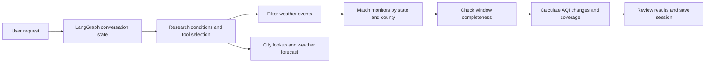

# AQI Analysis Agent 🌦️

**Explore air quality changes around weather events through natural language.**

A local research assistant built with **LangGraph, Ollama, and pandas**. The project connects conversational research workflows with weather-event records and ozone AQI observations in Texas, supporting event-window analysis, year-to-year comparisons, and city weather forecasts.

> The current version runs locally in a terminal. Historical analysis requires your own Excel datasets and local Ollama models. An online demo is not yet available.

## Features

| Feature | What it does |
| --- | --- |
| 💬 Conversational research | Set, update, or clear research conditions across multiple turns |
| 🌪️ Weather-event discovery | List available event types or filter them by region and year |
| 📊 Before-and-after analysis | Match events to monitoring sites in the same state and county, then compare AQI windows |
| 📅 Year-to-year comparison | Compare average AQI changes for the same event type across two years |
| 🔎 Coverage reporting | Inspect usable comparisons and exclusions caused by missing monitors or incomplete windows |
| 🧠 Persistent sessions | Save research conditions, conversation state, and analysis results in named local sessions |
| ☁️ Weather forecasts | Resolve city locations and retrieve forecasts from the US National Weather Service |

## Example conversation

The current prompts and session commands are primarily in Chinese. After starting the assistant, try these requests one at a time:

```text
我想研究得州 2024 年的 Flash Flood 对臭氧 AQI 的影响。
把分析窗口改成前后 7 天。
比较 2023 年和 2024 年的结果。
有多少条记录能完整比较？
查询 Houston 的近期天气。
```

In English, these requests mean: study ozone AQI changes around Texas flash floods in 2024, use seven-day windows, compare 2023 with 2024, inspect coverage, and look up Houston's weather.

These are example requests, not recorded results. Responses depend on dataset coverage, model interpretation, and external API availability. The assistant may ask for missing conditions before proceeding.

## How analysis works



Python functions perform the numerical analysis:

1. Filter events by region, event start year, and event type.
2. Match county-level events (`CZ_TYPE = C`) to monitors in the same state and county. Monitor identifiers combine `State Code`, `County Code`, `Site Num`, and `POC`.
3. Compare the **three days before the event starts** with the **three days after it ends** by default. Event days are excluded, and window lengths can be changed.
4. For multiple observations at the same monitor on the same day, use the daily median AQI. A monitor contributes only when every day in both windows has a valid value.
5. Calculate **after-window mean − before-window mean** for each complete monitor, average those changes within each event record, then give each comparable event record equal weight in the overall average.

A positive change means higher AQI after the event; a negative change means lower AQI. The year-to-year difference is **target-year average change − baseline-year average change**. Missing comparisons remain missing rather than being treated as zero.

> These are observational before-and-after differences, not estimates of causation. Event records and analysis windows may overlap, so records should not automatically be treated as independent events.

## Run locally

### 1. Clone the repository and install dependencies

Use Python 3.11 or later. On macOS or Linux:

```bash
git clone https://github.com/Veloraneeeee/AQI_analysis_agent.git
cd AQI_analysis_agent
python3 -m venv .venv
source .venv/bin/activate
python -m pip install langgraph langgraph-checkpoint-sqlite langchain-core langchain-ollama pandas openpyxl pydantic httpx
```

On Windows, activate the environment with `.venv\Scripts\Activate.ps1`.

The repository does not currently include a version-locked dependency manifest. The packages above are derived from source imports; compatibility across all latest package versions has not been verified.

### 2. Prepare Ollama models

Install and start [Ollama](https://ollama.com/), then download the two models configured in the source:

```bash
ollama pull qwen3:1.7b
ollama pull qwen3:4b
```

- `qwen3:1.7b` handles general conversation and conceptual questions.
- `qwen3:4b` interprets structured changes to research conditions.

Model names are configured in `main.py`. Keep the local Ollama service running while using the assistant. Model downloads and inference require local disk space, memory, and compute.

### 3. Prepare historical datasets

Create a `data/` directory at the repository root containing:

```text
data/
├── StormEvents_Combined_Fixed.xlsx
└── combined_daily_44201_2023_2025.xlsx
```

Paths and column mappings are defined in [`data_sources.py`](data_sources.py). These datasets are **not included in the public repository** and are not downloaded automatically. Supply files with the required columns below. Years in a filename do not guarantee complete coverage.

**Weather-event dataset**

| Column | Purpose |
| --- | --- |
| `EVENT_TYPE` | Event type, such as `Flash Flood` |
| `BEGIN_DATE_TIME` / `END_DATE_TIME` | Event start and end timestamps |
| `STATE_FIPS` / `CZ_FIPS` | State and county/zone codes |
| `CZ_TYPE` | Location type; `C` identifies county-level records |

**Ozone AQI dataset**

| Column | Purpose |
| --- | --- |
| `Date Local` | Observation date |
| `AQI` | AQI value |
| `State Code` / `County Code` | State and county identifiers |
| `Site Num` / `POC` | Site number and parameter occurrence code used to distinguish monitor records |

Historical analysis currently supports **Texas / TX / 得州 / 德州 / 德克萨斯州** and uses ozone AQI. Supporting other regions or pollutants requires changes to configuration and analysis logic, beyond updating a conversational condition.

Check that required columns are present:

```bash
python data_sources.py
```

This checks column names only; it does not validate dates, values, or complete observation windows.

### 4. Start the assistant

```bash
python main.py
```

The assistant starts with a temporary conversation. Use the existing Chinese commands below to manage sessions:

| Command | Action |
| --- | --- |
| `/会话 texas-study` | Create or resume a named session |
| `/恢复 texas-study` | Resume an existing session; keep the current conversation if it does not exist |
| `/新建` | Start a new temporary conversation while retaining existing named sessions |
| `退出` / `exit` / `quit` / `0` | Exit |

Named sessions are stored locally in `runtime/sessions.sqlite`. Temporary conversations are not saved after exit.

## Repository structure

```text
AQI_analysis_agent/
├── main.py                # Conversation agent, tool selection, and CLI entry point
├── analysis_graph.py      # LangGraph analysis workflow builder
├── aqi_analysis.py        # Windows, monitor matching, and annual comparisons
├── data_sources.py        # Dataset paths, column mappings, and region aliases
├── data_cache.py          # In-memory Excel cache
├── analysis_records.py    # Analysis records and metadata
├── saved_results.py       # Queries over saved analysis results
├── session_storage.py     # SQLite session persistence
├── online_weather.py      # City lookup and NWS forecasts
├── weather_dialog.py      # Weather dialogue and location disambiguation
├── studio_graph.py        # Studio entry point; currently needs an import fix
└── langgraph.json         # LangGraph Studio configuration
```

Use `python main.py` as the current entry point. `studio_graph.py` imports `main.builder`, which the current `main.py` does not export, so the Studio entry point requires repair before use.

## Data, privacy, and costs

- Historical analysis reads local Excel files. Local Ollama inference requires no cloud-model API key and incurs no per-request cloud-model charges.
- Weather queries require internet access. City lookup uses Open-Meteo Geocoding, and forecasts use the US National Weather Service. Search terms or coordinates are sent to the relevant service; availability and rate limits may affect results.
- `.gitignore` excludes `data/`, `.env`, `.venv/`, and SQLite/database files under `runtime/`. Keep personal session databases, credentials, and datasets without confirmed redistribution permission out of GitHub. Ignore rules do not remove files already tracked by Git.
- If a paid model is added later, configure credentials through environment variables or deployment secrets and set explicit usage limits.

## Current scope and next steps

This is an evolving learning and research project centered on local terminal interaction.

- A web interface, hosted service, and online demo are not yet available.
- Historical analysis requires user-supplied data and currently focuses on Texas ozone AQI.
- Natural-language interpretation depends on local models. Check the selected region, years, event type, and window lengths before interpreting results.
- Future improvements could include shareable sample datasets, reproducible dependency versions, automated tests, and visualizations.
